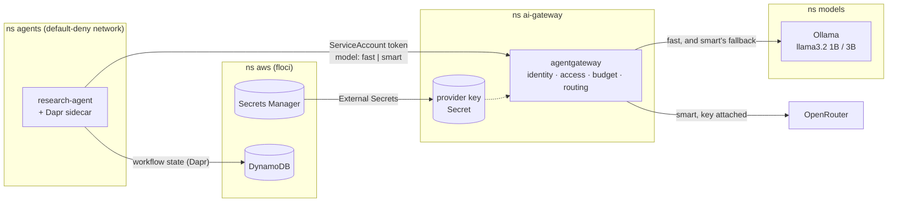

# Agentic developer platform

A local Kubernetes platform for running AI agents under the controls a production security review asks for. Agents hold no model credentials. One gateway authenticates every call, decides which models each agent may use, attaches provider keys, routes between hosted and small local models, and enforces a token budget per agent.



## What it does

| Property | How | Proof |
|---|---|---|
| Agents hold no model credential | Provider keys live in AWS Secrets Manager, are synced into the gateway's namespace only, and are attached by the gateway | `smoke.sh`: the key exists in one namespace |
| Callers are identified without shared keys | Agents present their Kubernetes ServiceAccount token (audience `ai-gateway`, one hour, auto-rotated); the gateway verifies it against the cluster's signing keys | `smoke.sh`: no token and wrong-audience token get 401 |
| Access is per identity, per model | Allow-lists on each model in `platform/gateway/models.yaml`; anything unlisted is denied | `smoke.sh`: `intern` gets 403 on `smart` |
| Agents ask for a capability, not a model | Aliases `fast` and `smart`; the catalogue maps them to real models and providers | `smoke.sh`: `fast` is answered by `llama3.2:1b` |
| Provider failover | `smart` tries the hosted model, then the local 3B model when the provider is down, throttling or rejecting the key | `smoke.sh`: `smart` answers with the placeholder key |
| Spend limit per agent | Token budget keyed on the caller's identity | Checked by hand: third call at a 30-token budget returned 429; another identity was unaffected |
| The gateway cannot be bypassed | Default-deny NetworkPolicy: agents reach the gateway and nothing else; only the gateway reaches models | `smoke.sh`: three blocked paths |
| Key rotation without redeploys | `scripts/provider-key.sh` writes Secrets Manager; External Secrets refreshes every minute | Checked by hand: new value reached the gateway in about 45 s |
| Agent work survives crashes | Dapr Workflow; model calls are recorded activities; state in DynamoDB behind Dapr's state API | `smoke.sh`: workflow completes |
| Hardened workloads | Pod Security `restricted` on every namespace we own; non-root, read-only root filesystem, no capabilities, no API token | Enforced by admission |
| Supply chain | Every image, chart, action and Python package pinned by version and digest or hash | `dagger call check` |

## Run it

Needs Docker with about 8 GB free, plus `k3d`, `kubectl`, `helm` and `jq` (pinned in `devbox.json`: `devbox shell`), and the Dagger CLI 0.21.11 for CI.

```sh
scripts/up.sh                       # cluster + platform, about 5 minutes cold; safe to re-run
scripts/smoke.sh                    # 14 end-to-end security checks
scripts/provider-key.sh openrouter  # optional: set a real hosted-provider key (prompts)
dagger call check                   # lint, unit tests, secret/misconfig/vulnerability scans
k3d cluster delete adp              # tear down
```

`up.sh` writes a repo-local `.kubeconfig` and leaves yours alone: `export KUBECONFIG=$PWD/.kubeconfig`.

Without a provider key, `smart` is served by the local fallback. Ask the agent something:

```sh
kubectl exec -n agents deploy/research-agent -c agent -- python app.py ask "Why is the sky blue?"
```

## Layout

| Path | What |
|---|---|
| `versions.env` | Every external version in one place |
| `scripts/up.sh` | The whole bootstrap, in order |
| `platform/gateway/` | Gateway, model catalogue and access, caller identity and budgets, network policy |
| `platform/models/` | In-cluster Ollama |
| `platform/aws/` | floci, standing in for the AWS account |
| `platform/secrets/` | Secrets Manager to gateway key sync |
| `platform/dapr/` | State store component and Dapr configuration for agents |
| `platform/agents/` | Tenant namespace policy and the sample agent's deployment |
| `agent/` | The sample durable agent |
| `.dagger/` | CI pipeline |
| `docs/` | Decisions, threat model, source of each practice |

## Common changes

- **Point an alias at another model or provider:** edit `platform/gateway/models.yaml`, re-run `up.sh`. No agent changes.
- **Add a provider:** add a Secrets Manager secret and an `ExternalSecret` (`platform/secrets/`), then an internal model with `auth.secretRef` and an allow-list.
- **Onboard an agent:** a ServiceAccount in `agents`, its identity added to the models it may use.
- **Move to real AWS:** remove the floci endpoint overrides and the dummy credential Secrets; give External Secrets and the agent's sidecar IAM roles (IRSA or Pod Identity). The manifests' comments mark each spot.

## Known gaps

Tracked in beads (`bd ready`); the security-relevant ones are also in `docs/threat-model.md`. The largest: traffic to the gateway is plain HTTP inside the cluster, there is no tracing or eval gate yet, the tool (MCP) hop is not built, and the hosted-provider path has only been exercised with a placeholder key.
