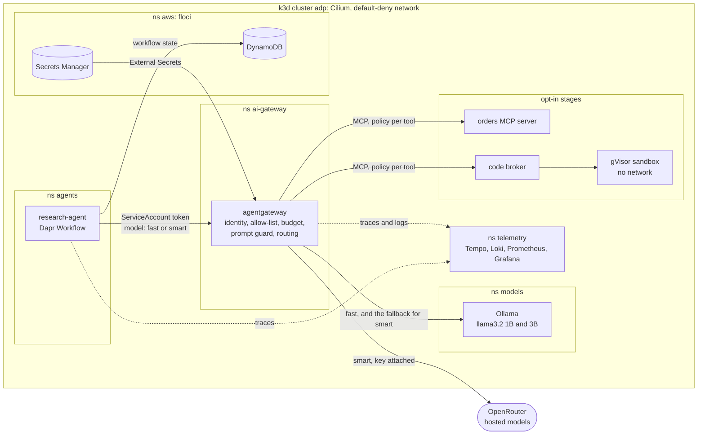
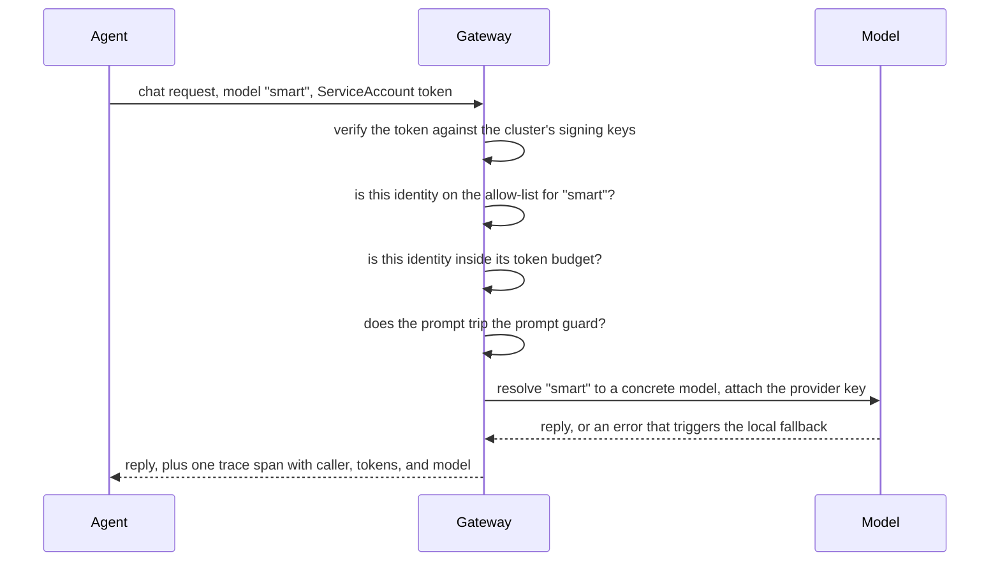
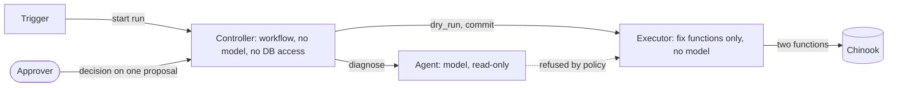

# Agentic developer platform

> **Bottom line.** AI agents here hold no model credentials and have one way out of their namespace: a gateway that knows which workload is calling. The gateway decides which models and tools each agent may use, attaches the provider key, enforces a token budget per agent, and falls back to a local model when the provider fails. The whole platform runs on one laptop, and 86 scripted checks try to break its controls.

Three facts back that up:

- **Every control names its proof.** Each row in the tables below names the check that fails if the control breaks. The repo's rule is that every deny check keeps an allow check beside it, so a broken test cannot pass as a working fence.
- **It is built for a security review.** [docs/threat-model.md](docs/threat-model.md) lists 22 threats with the control and the check for each, and the risks that are still open. The 19 decision records in [docs/adr/](docs/adr/) give the reason for each choice.
- **It moves to real AWS by removing things.** [floci](https://floci.io/) stands in for Secrets Manager and DynamoDB. Comments in the manifests mark each endpoint override and dummy credential that an IAM role replaces.

## Why this is useful

A team that ships an agent usually gives it a provider API key and open egress. A hijacked prompt can then spend the key, leak the key, or send data anywhere.

This platform takes those decisions away from the agent. Onboarding an agent is a ServiceAccount and an allow-list entry. The agent asks for a capability (`fast` or `smart`), not for a model, so the platform team can change the model or the provider in one reviewed file with no agent change.

## How it fits together



One model call passes five decisions before any model sees it. The agent makes none of them.



## What it does

| Property | How | Proof |
|---|---|---|
| Agents hold no model credential | Provider keys live in AWS Secrets Manager, are synced into the gateway's namespace only, and are attached by the gateway | `smoke.sh`: the key exists in one namespace |
| Callers are identified without shared keys | Agents present their Kubernetes ServiceAccount token (audience `ai-gateway`, one hour, auto-rotated); the gateway verifies it against the cluster's signing keys | `smoke.sh`: no token and wrong-audience token get 401 |
| Access is per identity, per model | Allow-lists on each model in `platform/gateway/models.yaml`; anything unlisted is denied | `smoke.sh`: `intern` gets 403 on `smart` |
| Agents ask for a capability, not a model | Aliases `fast` and `smart`; the catalogue maps them to real models and providers | `smoke.sh`: `fast` is answered by `llama3.2:1b` |
| Provider failover | `smart` tries the hosted model, then the local 3B model when the provider is down, throttling or rejecting the key | `smoke.sh`: `smart` answers with the placeholder key |
| Spend limit per agent | Token budget keyed on the caller's identity | Checked by hand: third call at a 30-token budget returned 429; another identity was unaffected |
| The gateway cannot be bypassed | Default-deny NetworkPolicy: agents reach the gateway and nothing else; only the gateway reaches models | `smoke.sh`: three blocked paths |
| Key rotation without redeploys | `scripts/provider-key.sh` writes Secrets Manager; External Secrets refreshes every minute | Checked by hand: new value reached the gateway in about 45 s |
| Agent work survives crashes | Dapr Workflow; model calls are recorded activities; state in DynamoDB behind Dapr's state API | `smoke.sh`: workflow completes |
| Hardened workloads | Pod Security `restricted` on every namespace we own; non-root, read-only root filesystem, no capabilities, no API token | Enforced by admission |
| One trace per agent run | The agent opens a span per workflow run and per activity and sends `traceparent`; the gateway exports a span per model and tool call with the caller's `jwt.sub`, tokens, model and the endpoint that answered (Tempo in the otel-lgtm stack, `platform/telemetry/`); its access log goes to Loki with the same trace id | `smoke.sh`: one run is one trace across both; every gateway call nests under an agent span; the run's access log is in Loki |
| Supply chain | Every image, chart, action and Python package pinned by version and digest or hash | `dagger call check` |

## Run it

Needs Docker with about 8 GB free, plus `k3d`, `kubectl`, `helm` and `jq` (pinned in `devbox.json`: `devbox shell`), and the Dagger CLI 0.21.11 for CI.

```sh
scripts/up.sh                       # cluster + platform, about 5 minutes cold; safe to re-run
scripts/smoke.sh                    # 38 end-to-end security checks (one skips without a host model)
scripts/provider-key.sh openrouter  # optional: set a real hosted-provider key (prompts)
dagger call check                   # lint, unit tests, boundary register, harness lock, Renovate config, secret/misconfig/vulnerability scans
dagger call renovate --token=cmd://"gh auth token"   # what Renovate would bump (no PRs; ADR 0012)
k3d cluster delete adp              # tear down
```

`up.sh` writes a repo-local `.kubeconfig` and leaves yours alone: `export KUBECONFIG=$PWD/.kubeconfig`.

Observability (ADR 0017): `kubectl port-forward -n telemetry svc/lgtm 3000`, then http://localhost:3000. That is Grafana over Tempo (traces), Loki (the gateway's access log), Prometheus (metrics and alert rules) and Alertmanager, read-only, with no login. `app.py ask` and `app.py order` print the run's `trace_id`; search it in Tempo, or in Loki with `{service_name="ai-gateway"} | trace_id="<id>"`. Nothing in the cluster can reach the query ports. The "ADP: AI gateway" dashboard is in the ADP folder. History is on a PersistentVolumeClaim and survives a pod restart, not a cluster delete; alerts are delivered to `alert-receiver` (`kubectl logs -n telemetry deploy/alert-receiver`).

Without a provider key, `smart` is served by a local model: the host's GPU model when it is running (`scripts/host-model.sh up`: Ollama under launchd, loopback only, `llama3.2:3b` pinned by digest, ADR 0018; the cluster reaches it at `host.docker.internal`), otherwise the in-cluster one, which on CPU is too slow for the ERP agent. Ask the agent something:

```sh
kubectl exec -n agents deploy/research-agent -c agent -- python app.py ask "Why is the sky blue?"
```

## Tools over MCP (opt-in)

The order tools from AWS's *Secure AI Agents on Amazon EKS* workshop (labs 3 and 4), behind the same gateway on its `mcp` listener (`:8081/mcp`). `tools/orders-mcp/server.py` is the workshop's file unchanged; it reads DynamoDB on floci because boto3 takes `AWS_ENDPOINT_URL` from the environment. Callers authenticate with their ServiceAccount token, as for models. Which identity may use which tool is one policy (`tools/deploy/gateway-mcp.yaml`), and a tool a caller may not use is not refused but absent: it is missing from that caller's `tools/list`, and calling it gets the same error as a tool that does not exist.

| Tool | research-agent | intern |
|---|---|---|
| `lookup_order` | yes | yes |
| `initiate_return` | yes | no |
| `check_inventory` | no | no (no rule allows it) |

```sh
scripts/tools-up.sh     # after up.sh: image, orders table, server, route, policy
scripts/tools-smoke.sh  # 20 checks: identity, visibility, calls, the agent's tool workflow, isolation
kubectl exec -n agents deploy/research-agent -c agent -- python app.py order ORD-1001
```

The sample agent's `order_status` workflow calls `lookup_order` as a workflow activity, like a model call: recorded, so a resumed run does not repeat it. Its MCP client is about forty lines of standard library (`agent/app.py`), and the gateway, not the agent, decides which tools it has.

Tool output is data, not instructions. Two layers, tested with a hostile record (`ORD-6666`, whose customer name tells the model to approve a refund):

- **Structural (the defense):** the record reaches a model step that has no tools, framed as data in a system message and a delimited block, and whose only output is reply text. A successful injection can word a reply badly; it cannot act.
- **Gateway prompt guard (a tripwire):** `platform/gateway/guardrails.yaml` rejects requests carrying known injection phrases before any model sees them (403, logged). It catches only the phrasings it lists.

With the guard removed, the local 3B model given the hostile record wrote a plain shipping reply in 4 of 4 runs; that is a small sample, not a guarantee. Not built: an output-side check of what a reply may claim, and a classifier-grade guard (the policy also takes a webhook, OpenAI Moderation, Bedrock Guardrails or Model Armor).

## Sandboxed code execution (opt-in)

The workshop's lab 5. One tool, `run_python`, on the `mcp` listener at `/code-mcp`, for research-agent only. The broker (`sandbox/broker/`, upstream's files unchanged) fetches a scoped slice of orders itself with a parameterized query and hands the rows and the model's code to a sandbox as files, so the rows never pass through the model. The sandbox is a gVisor pod claimed from a warm pool and destroyed after the call: its own kernel, an enforced seccomp profile, no Kubernetes credential, and no network.

| Property | How | Proof in `scripts/sandbox-smoke.sh` |
|---|---|---|
| Its own kernel | `runtimeClassName: gvisor` (no `/dev/kvm` in a k3d node, so gVisor rather than the workshop's Firecracker microVMs) | `uname -r` differs from the node's |
| Seccomp enforced inside the sandbox | runsc `oci-seccomp = "true"`; without it `RuntimeDefault` passes admission and is ignored | `Seccomp: 2`; `unshare(CLONE_NEWUSER)` is EPERM |
| Air-gapped while it runs | the air gap selects `sandbox-kind`, which a pod keeps when claimed; the workshop's policy selects a label the controller removes on claim (`agent-sandbox` defect 001, fails open) | a claimed sandbox cannot reach the internet or the API server; a control pod with the same runtime can |
| Pod Security `restricted` | the template, router and controller carry a compliant `securityContext`; without it admission refuses the pods and the only trace is the Sandbox's `Ready=False` | both warm-pool pods Ready |
| Only research-agent can run code | per-tool policy on the broker's route | in research-agent's `tools/list`, "unknown resource" for intern |

```sh
scripts/sandbox-up.sh     # after up.sh and tools-up.sh: gVisor on the agent node (restarts it), agent-sandbox, broker
scripts/sandbox-smoke.sh  # 15 checks
```

gVisor's isolation is weaker than a microVM's: the untrusted code talks to a kernel written in Go in userspace, and a Linux kernel escape from gVisor lands on the node.

## ERP discrepancy agent

A tenant of the platform: it finds business data that breaks a rule, has a model propose a typed fix, and applies the fix only after a named person approves that exact proposal. Terms are defined in [CONTEXT.md](CONTEXT.md); decisions are ADRs 0005 to 0011.



| Property | Proof in `scripts/erp-smoke.sh` |
|---|---|
| A fix is applied only after a named approver approves that exact proposal | Approving a different proposal, or as nobody, changes nothing; a valid approval commits and the audit row names the approver |
| Rejection and "fixed by other means" apply nothing | Both end the run without a commit |
| Only the executor and the agent can reach the database, each as its own role | The controller cannot open a connection |
| A hijacked agent cannot commit | The agent's code is replaced with a direct call to `commit`; the executor's sidecar refuses it |

```bash
scripts/up.sh         # the platform
scripts/erp-up.sh     # this tenant
scripts/erp-smoke.sh  # 13 checks of the mechanics, with a scripted model; ERP_SMOKE_ALIAS=smart for a real one
```

Built so far: the three workloads, access policies, typed fixes enforced by database roles, approval bound to a proposal hash, deadlines with escalation, and the LangGraph diagnosis graph (gather facts, model chooses a declared fix, validate).

A run against a real model needs the host's Ollama (see Run it) or a hosted provider key: the in-cluster CPU models generate under one token per second, so a diagnosis times out. With the host's `llama3.2:3b` (about 120 tokens per second on the development machine), `ERP_SMOKE_ALIAS=smart scripts/erp-smoke.sh` passes in under a minute. Without one, `scripts/erp-smoke.sh` still checks every mechanism: by default the agent diagnoses through the `scripted` alias, a model behind the gateway that gives one fixed answer (`platform/models/scripted.yaml`).

Not built yet: the Drasi trigger, Keycloak-verified approvers, and the eval gate.

## Layout

| Path | What |
|---|---|
| `versions.env` | Every external version in one place |
| `scripts/up.sh` | The whole bootstrap, in order |
| `platform/gateway/` | Gateway, model catalogue and access, caller identity and budgets, network policy |
| `platform/models/` | In-cluster Ollama |
| `platform/aws/` | floci, standing in for the AWS account |
| `platform/secrets/` | Secrets Manager to gateway key sync |
| `platform/dapr/` | State store component and Dapr configuration for agents |
| `platform/telemetry/` | otel-lgtm (Collector, Prometheus, Tempo, Loki, Grafana) plus Alertmanager: OTLP in from the gateway and agents, alert rules tested by promtool, query by port-forward only (ADR 0017) |
| `platform/agents/` | Tenant namespace policy and the sample agent's deployment |
| `agent/` | The sample durable agent |
| `tools/` | The opt-in tools stage: the workshop's orders MCP server and its gateway route and policy |
| `sandbox/` | The opt-in sandbox stage: the workshop's code-execution broker, the sandbox runtime, gVisor and agent-sandbox |
| `.dagger/` | CI pipeline |
| `boundary_register.yaml`, `tools/boundary/` | Identifiers two components must agree on, verified in CI ([docs/boundary-register.md](docs/boundary-register.md)) |
| `docs/` | Decisions, threat model, source of each practice |

## Common changes

- **Point an alias at another model or provider:** edit `platform/gateway/models.yaml`, re-run `up.sh`. No agent changes.
- **Add a provider:** add a Secrets Manager secret and an `ExternalSecret` (`platform/secrets/`), then an internal model with `auth.secretRef` and an allow-list.
- **Onboard an agent:** a ServiceAccount in `agents`, its identity added to the models it may use, and a `principal-*` entry in `boundary_register.yaml`.
- **Pull ADR 0014 onto an existing cluster:** `scripts/up.sh` stops, because the cluster still runs flannel. Recreate it: `k3d cluster delete adp && scripts/up.sh`.
- **Edit anything under `.claude/`, or `.mcp.json`, `AGENTS.md`, `CLAUDE.md`:** `dagger call check` goes red until you run `python3 tools/harness/harness.py lock` and commit `harness.lock` (ADR 0013).
- **Edit any file `boundary_register.yaml` cites:** `dagger call check` goes red (STALE) until you run `tools/boundary/boundary.py refresh` ([docs/boundary-register.md](docs/boundary-register.md)).
- **Move to real AWS:** remove the floci endpoint overrides and the dummy credential Secrets; give External Secrets and the agent's sidecar IAM roles (IRSA or Pod Identity). The manifests' comments mark each spot.

## Known gaps

Tracked in beads (`bd ready`). The security-relevant gaps are also in [docs/threat-model.md](docs/threat-model.md), under Open risks. The largest:

- Traffic to the gateway is plain HTTP inside the cluster.
- No eval gate checks a model or prompt change behind an alias.
- The hosted-provider path has run only with a placeholder key.
- Telemetry lives on one node, and alerts reach a webhook that logs them, not a person.
- Images are pinned by digest but not signed.
- Nothing here ran at production scale or against real AWS.
