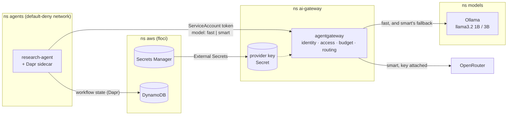

# Agentic developer platform

A local Kubernetes platform for running AI agents under the controls a production security review asks for. Agents hold no model credentials. One gateway authenticates every call, decides which models each agent may use, attaches provider keys, routes between hosted and small local models, and enforces a token budget per agent.



## What it does

| Property | How | Proof |
|---|---|---|
| Agents hold no model credential | Provider keys live in AWS Secrets Manager, are synced into the gateway's namespace only, and are attached by the gateway | `smoke.sh`: the key exists in one namespace |
| Callers are identified without shared keys | Agents present their Kubernetes ServiceAccount token (audience `ai-gateway`, one hour, auto-rotated); the gateway verifies it against the cluster's signing keys | `smoke.sh`: no token and wrong-audience token get 401 |
| Access is per identity, per model | Allow-lists on each model in `platform/gateway/models.yaml`; anything unlisted is denied | `smoke.sh`: `intern` gets 403 on `smart` |
| Agents ask for a capability, not a model | Aliases `fast` and `smart`; the catalogue maps them to real models and providers | `smoke.sh`: `fast` is answered by `llama3.2:1b` |
| Provider failover | `smart` tries the hosted model, then the local 3B model when the provider is down, throttling or rejecting the key | `smoke.sh`: `smart` answers with the placeholder key |
| Spend limit per agent | Token budget keyed on the caller's identity | Checked by hand: third call at a 30-token budget returned 429; another identity was unaffected |
| The gateway cannot be bypassed | Default-deny NetworkPolicy: agents reach the gateway and nothing else; only the gateway reaches models | `smoke.sh`: three blocked paths |
| Key rotation without redeploys | `scripts/provider-key.sh` writes Secrets Manager; External Secrets refreshes every minute | Checked by hand: new value reached the gateway in about 45 s |
| Agent work survives crashes | Dapr Workflow; model calls are recorded activities; state in DynamoDB behind Dapr's state API | `smoke.sh`: workflow completes |
| Hardened workloads | Pod Security `restricted` on every namespace we own; non-root, read-only root filesystem, no capabilities, no API token | Enforced by admission |
| One trace per agent run | The agent opens a span per workflow run and per activity and sends `traceparent`; the gateway exports a span per model and tool call with the caller's `jwt.sub`, tokens, model and the endpoint that answered (Jaeger v2, `platform/telemetry/`) | `smoke.sh`: one run is one trace across both; every gateway call nests under an agent span |
| Supply chain | Every image, chart, action and Python package pinned by version and digest or hash | `dagger call check` |

## Run it

Needs Docker with about 8 GB free, plus `k3d`, `kubectl`, `helm` and `jq` (pinned in `devbox.json`: `devbox shell`), and the Dagger CLI 0.21.11 for CI.

```sh
scripts/up.sh                       # cluster + platform, about 5 minutes cold; safe to re-run
scripts/smoke.sh                    # 21 end-to-end security checks (one skips without a host model)
scripts/provider-key.sh openrouter  # optional: set a real hosted-provider key (prompts)
dagger call check                   # lint, unit tests, boundary register, secret/misconfig/vulnerability scans
k3d cluster delete adp              # tear down
```

`up.sh` writes a repo-local `.kubeconfig` and leaves yours alone: `export KUBECONFIG=$PWD/.kubeconfig`.

Traces: `kubectl port-forward -n telemetry svc/jaeger 16686`, then http://localhost:16686. `app.py ask` and `app.py order` print the run's `trace_id`. Nothing in the cluster can reach the query port. Storage is in memory, so traces do not survive a restart of the Jaeger pod.

Without a provider key, `smart` is served by a local model: the host's Ollama when it is running (`ollama pull llama3.2:3b && ollama serve`; the cluster reaches it at `host.docker.internal`), otherwise the in-cluster one, which on CPU is too slow for the ERP agent. Ask the agent something:

```sh
kubectl exec -n agents deploy/research-agent -c agent -- python app.py ask "Why is the sky blue?"
```

## Tools over MCP (opt-in)

The order tools from AWS's *Secure AI Agents on Amazon EKS* workshop (labs 3 and 4), behind the same gateway on its `mcp` listener (`:8081/mcp`). `tools/orders-mcp/server.py` is the workshop's file unchanged; it reads DynamoDB on floci because boto3 takes `AWS_ENDPOINT_URL` from the environment. Callers authenticate with their ServiceAccount token, as for models. Which identity may use which tool is one policy (`tools/deploy/gateway-mcp.yaml`), and a tool a caller may not use is not refused but absent: it is missing from that caller's `tools/list`, and calling it gets the same error as a tool that does not exist.

| Tool | research-agent | intern |
|---|---|---|
| `lookup_order` | yes | yes |
| `initiate_return` | yes | no |
| `check_inventory` | no | no (no rule allows it) |

```sh
scripts/tools-up.sh     # after up.sh: image, orders table, server, route, policy
scripts/tools-smoke.sh  # 20 checks: identity, visibility, calls, the agent's tool workflow, isolation
kubectl exec -n agents deploy/research-agent -c agent -- python app.py order ORD-1001
```

The sample agent's `order_status` workflow calls `lookup_order` as a workflow activity, like a model call: recorded, so a resumed run does not repeat it. Its MCP client is about forty lines of standard library (`agent/app.py`), and the gateway, not the agent, decides which tools it has.

Tool output is data, not instructions. Two layers, tested with a hostile record (`ORD-6666`, whose customer name tells the model to approve a refund):

- **Structural (the defense):** the record reaches a model step that has no tools, framed as data in a system message and a delimited block, and whose only output is reply text. A successful injection can word a reply badly; it cannot act.
- **Gateway prompt guard (a tripwire):** `platform/gateway/guardrails.yaml` rejects requests carrying known injection phrases before any model sees them (403, logged). It catches only the phrasings it lists.

With the guard removed, the local 3B model given the hostile record wrote a plain shipping reply in 4 of 4 runs; that is a small sample, not a guarantee. Not built: an output-side check of what a reply may claim, and a classifier-grade guard (the policy also takes a webhook, OpenAI Moderation, Bedrock Guardrails or Model Armor).

## ERP discrepancy agent (branch `erp-discrepancy-agent`)

A tenant of the platform: it finds business data that breaks a rule, has a model propose a typed fix, and applies the fix only after a named person approves that exact proposal. Terms are defined in [CONTEXT.md](CONTEXT.md); decisions are ADRs 0005 to 0011.


| Property | Proof in `scripts/erp-smoke.sh` |
|---|---|
| A fix is applied only after a named approver approves that exact proposal | Approving a different proposal, or as nobody, changes nothing; a valid approval commits and the audit row names the approver |
| Rejection and "fixed by other means" apply nothing | Both end the run without a commit |
| Only the executor and the agent can reach the database, each as its own role | The controller cannot open a connection |
| A hijacked agent cannot commit | The agent's code is replaced with a direct call to `commit`; the executor's sidecar refuses it |

```bash
scripts/up.sh         # the platform
scripts/erp-up.sh     # this tenant
scripts/erp-smoke.sh  # the mechanics, with a scripted model; ERP_SMOKE_ALIAS=smart for a real one
```

Built so far: the three workloads, access policies, typed fixes enforced by database roles, approval bound to a proposal hash, deadlines with escalation, and the LangGraph diagnosis graph (gather facts, model chooses a declared fix, validate).

A run against a real model needs the host's Ollama (see Run it) or a hosted provider key: the in-cluster CPU models generate under one token per second, so a diagnosis times out. With the host's `llama3.2:3b` (about 120 tokens per second on the development machine), `ERP_SMOKE_ALIAS=smart scripts/erp-smoke.sh` passes in under a minute. Without one, `scripts/erp-smoke.sh` still checks every mechanism: by default the agent diagnoses through the `scripted` alias, a model behind the gateway that gives one fixed answer (`platform/models/scripted.yaml`).

Not built yet: the Drasi trigger, Keycloak-verified approvers, and the eval gate.

## Layout

| Path | What |
|---|---|
| `versions.env` | Every external version in one place |
| `scripts/up.sh` | The whole bootstrap, in order |
| `platform/gateway/` | Gateway, model catalogue and access, caller identity and budgets, network policy |
| `platform/models/` | In-cluster Ollama |
| `platform/aws/` | floci, standing in for the AWS account |
| `platform/secrets/` | Secrets Manager to gateway key sync |
| `platform/dapr/` | State store component and Dapr configuration for agents |
| `platform/telemetry/` | Jaeger v2 (an OpenTelemetry Collector distribution): OTLP in from the gateway and agents, query by port-forward only |
| `platform/agents/` | Tenant namespace policy and the sample agent's deployment |
| `agent/` | The sample durable agent |
| `tools/` | The opt-in tools stage: the workshop's orders MCP server and its gateway route and policy |
| `.dagger/` | CI pipeline |
| `boundary_register.yaml`, `tools/boundary/` | Identifiers two components must agree on, verified in CI ([docs/boundary-register.md](docs/boundary-register.md)) |
| `docs/` | Decisions, threat model, source of each practice |

## Common changes

- **Point an alias at another model or provider:** edit `platform/gateway/models.yaml`, re-run `up.sh`. No agent changes.
- **Add a provider:** add a Secrets Manager secret and an `ExternalSecret` (`platform/secrets/`), then an internal model with `auth.secretRef` and an allow-list.
- **Onboard an agent:** a ServiceAccount in `agents`, its identity added to the models it may use, and a `principal-*` entry in `boundary_register.yaml`.
- **Edit any file `boundary_register.yaml` cites:** `dagger call check` goes red (STALE) until you run `tools/boundary/boundary.py refresh` ([docs/boundary-register.md](docs/boundary-register.md)).
- **Move to real AWS:** remove the floci endpoint overrides and the dummy credential Secrets; give External Secrets and the agent's sidecar IAM roles (IRSA or Pod Identity). The manifests' comments mark each spot.

## Known gaps

Tracked in beads (`bd ready`); the security-relevant ones are also in `docs/threat-model.md`. The largest: traffic to the gateway is plain HTTP inside the cluster, there is no tracing or eval gate yet, the tool (MCP) hop is not built, and the hosted-provider path has only been exercised with a placeholder key.
